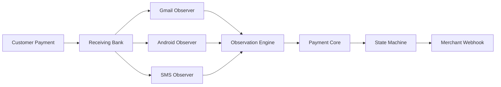
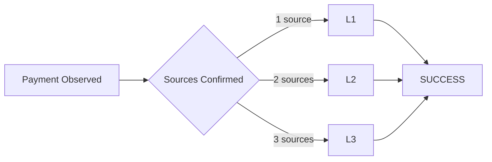
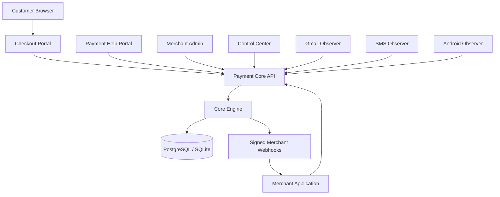
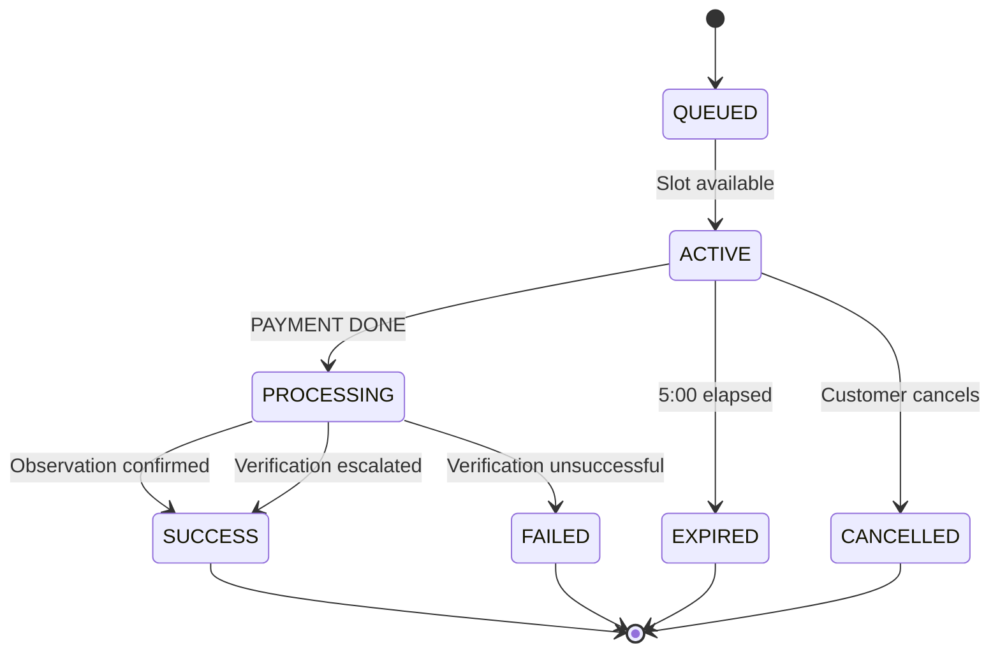

# YOUPI PG

### Self-Hosted • White-Label • Deterministic UPI Payment Gateway

[](#)
[](#)
[](#)
[](#)
[](#)
[](#)

> **YOUPI PG** is a self-hosted, white-label UPI payment gateway built around deterministic payment attribution, sequential payment processing, multi-channel payment observation, and merchant-controlled operations.

YOUPI PG is designed so every deployment can operate as an **independent payment instance** with its own database, merchant configuration, receiving accounts, observers, customers, branding, and support environment.

---

## ✨ What Is YOUPI PG?

YOUPI PG provides a complete payment-processing stack for merchants that want to operate their own UPI gateway infrastructure.

Instead of relying on a shared hosted gateway, every YOUPI PG installation can maintain its own:

* Payment API
* Checkout experience
* Merchant administration panel
* Payment observation services
* Receiving UPI accounts
* Database
* White-label configuration
* Customer support portal
* Android observer device
* Operational control center

The entire stack is distributed as **self-hostable source code** and runs using native host processes.

---

# 🧠 Core Design Philosophy

YOUPI PG is built around a few strict system invariants.

### 01 — Self-Hosted Independence

Every installation is an isolated gateway instance.

```text
                 YOUPI PG INSTANCE
                        │
        ┌───────────────┼────────────────┐
        │               │                │
     Database        Merchant          Observers
        │             Config              │
        │               │          ┌──────┼──────┐
        │               │          │      │      │
      Orders         Branding     Gmail   SMS  Android
        │
     Customers
```

One installation does not depend on another installation's database, merchant accounts, or operational state.

---

### 02 — Deterministic Payment Attribution

Payment attribution follows one primary rule:

```text
expected_amount == observed_amount
```

The system does not rely on vague similarity, fuzzy matching, or heuristic payment assignment.

A payment is attributed only when the observed payment amount exactly matches the expected amount for the active payment session.

---

### 03 — Single Active Payment Slot

Each receiving account maintains exactly **one active payment session** at a time.

```text
              RECEIVING ACCOUNT
                     │
             ┌───────┴────────┐
             │                │
           ACTIVE          QUEUED
          Payment #1      Payment #2
             │                │
        5:00 window         waiting
             │
        PROCESSING
          Payment #1
             │
           0:30
      verification
             │
          RESULT
             │
        ┌────┴────┐
        ↓         ↓
      Next      Failed/
      Queue     Expired
```

This sequential model prevents simultaneous amount-matching conflicts on the same receiving account.

---

# 🔭 Tri-Channel Payment Observation

YOUPI PG can observe payment notifications through three independent channels.

| Channel           | Technology                    | Purpose                                |
| ----------------- | ----------------------------- | -------------------------------------- |
| 📧 Gmail          | Google OAuth2                 | Parse bank credit notifications        |
| 📱 Android        | `NotificationListenerService` | Observe banking notifications directly |
| 💬 SMS / Messages | Google Messages automation    | Observe SMS-based bank alerts          |

All observation sources feed into the same verification pipeline.



---

# ⏱️ Immutable Payment Timers

YOUPI PG uses two server-authoritative timers.

### Timer 1 — Payment Window

**5:00**

Begins when the customer's payment session becomes active.

The timer:

* Is controlled by the server
* Survives browser refreshes
* Is not dependent on client-side JavaScript time
* Remains authoritative across server restarts

### Timer 2 — Verification Window

**0:30**

Begins only after the customer explicitly selects:

```text
PAYMENT DONE — CHECK MY PAYMENT
```

During this period the observation engine continues polling all configured channels.

```text
PAYMENT CREATED
      │
      ▼
  ┌─────────┐
  │  5:00   │
  │ PAYMENT │
  └────┬────┘
       │
       │ Customer confirms payment
       ▼
  ┌─────────┐
  │  0:30   │
  │ VERIFY  │
  └────┬────┘
       │
       ▼
    RESULT
```

---

# 🔐 Multi-Level Verification

YOUPI PG supports progressive verification across observation channels.

### L1 — Single Verification

At least **one configured observation channel** confirms the payment.

The transaction can immediately enter:

```text
SUCCESS
```

without requiring the customer to wait for additional sources.

### L2 — Dual Verification

Two independent channels confirm the same payment.

Example:

```text
Gmail + SMS
```

### L3 — Triple Verification

All three configured observation channels confirm the payment.

```text
Gmail + SMS + Android
```

During the 30-second verification period, YOUPI PG continues observing available sources so the verification level can progress from L1 → L2 → L3.



---

# 🎯 Clean Merchant Contract

External merchants do not need to understand internal observation states.

The gateway exposes four terminal payment outcomes:

```text
SUCCESS
FAILED
EXPIRED
CANCELLED
```

This keeps merchant integrations simple while allowing the internal payment engine to remain significantly more sophisticated.

---

# 🏗️ System Architecture



---

# 📦 Workspace Structure

```text
youpi-pg/
│
├── package.json
├── ARCHITECTURE.md
├── .env.example
│
├── apps/
│   │
│   ├── control-center/
│   │   └── Local process supervisor
│   │
│   ├── payment-api/
│   │   └── Backend payment core & REST API
│   │
│   ├── checkout-portal/
│   │   └── Customer checkout interface
│   │
│   ├── merchant-admin/
│   │   └── Merchant administration dashboard
│   │
│   ├── payment-help/
│   │   └── Customer payment help portal
│   │
│   ├── gmail-observer/
│   │   └── Gmail OAuth2 observation service
│   │
│   ├── sms-observer/
│   │   └── SMS / Google Messages observation service
│   │
│   └── android-observer-app/
│       └── Native Android Kotlin observer
│
├── packages/
│   │
│   ├── common/
│   │   └── Shared types, enums, crypto & paise utilities
│   │
│   ├── db/
│   │   └── Database client, migrations & repositories
│   │
│   ├── core/
│   │   └── State machine, queue, timers & webhooks
│   │
│   ├── observer-sdk/
│   │   └── Observer ingestion SDK
│   │
│   └── merchant-sdk/
│       └── Node.js merchant integration SDK
│
├── docs/
│   └── Operational & integration documentation
│
└── scripts/
    ├── dev.js
    ├── clean.js
    └── chaos-concurrency.test.js
```

---

# 🌐 Port Topology

| Service              |   Port | Environment Variable   | Responsibility                     |
| -------------------- | -----: | ---------------------- | ---------------------------------- |
| **Control Center**   | `8090` | `CONTROL_CENTER_PORT`  | Process supervision, logs & health |
| **Payment Core API** | `6100` | `PAYMENT_API_PORT`     | REST API, SSE & observation intake |
| **Checkout Portal**  | `7000` | `CHECKOUT_PORTAL_PORT` | Customer checkout & dynamic UPI QR |
| **Merchant Admin**   | `6001` | `MERCHANT_ADMIN_PORT`  | Merchant dashboard & operations    |
| **Payment Help**     | `3000` | `HELP_PORTAL_PORT`     | Customer history & support         |
| **SMS Observer**     | `6002` | `SMS_OBSERVER_PORT`    | SMS / Messages observation         |
| **Gmail Observer**   | `6003` | `GMAIL_OBSERVER_PORT`  | Gmail polling & OAuth callback     |

---

# 🚀 Quick Start

## Requirements

YOUPI PG runs as native host processes.

### Supported

* Linux
* Windows
* Node.js `20+`
* Node.js `24 LTS` recommended
* PostgreSQL
* SQLite
* Android device for Android observation

### No Docker Required

The system is designed around direct host execution.

---

## 1. Clone the Repository

```bash
git clone https://github.com/your-org/youpi-pg.git
cd youpi-pg
```

---

## 2. Configure the Environment

```bash
cp .env.example .env
```

Then configure the required database, authentication, observer, merchant and deployment settings.

```env
DATABASE_URL=
PAYMENT_API_PORT=6100
CHECKOUT_PORTAL_PORT=7000
MERCHANT_ADMIN_PORT=6001
HELP_PORTAL_PORT=3000
GMAIL_OBSERVER_PORT=6003
SMS_OBSERVER_PORT=6002
CONTROL_CENTER_PORT=8090
```

> Never commit production secrets or private credentials to Git.

---

## 3. Initialize the Database

Run the migration system:

```bash
node packages/db/src/migrate.js
```

This initializes the schema and default seed data required by the instance.

---

## 4. Run Tests

### Common

```bash
node --test packages/common/src/__tests__/**/*.test.js
```

### Database

```bash
node --test packages/db/src/__tests__/**/*.test.js
```

### Core Engine

```bash
node --test packages/core/src/__tests__/**/*.test.js
```

### Payment API

```bash
node --test apps/payment-api/src/__tests__/**/*.test.js
```

### Checkout

```bash
node --test apps/checkout-portal/src/__tests__/**/*.test.js
```

### Merchant Admin

```bash
node --test apps/merchant-admin/src/__tests__/**/*.test.js
```

### Payment Help

```bash
node --test apps/payment-help/src/__tests__/**/*.test.js
```

### Gmail Observer

```bash
node --test apps/gmail-observer/src/__tests__/**/*.test.js
```

### SMS Observer

```bash
node --test apps/sms-observer/src/__tests__/**/*.test.js
```

### Android Observer

```bash
node --test apps/android-observer-app/__tests__/**/*.test.js
```

### Merchant SDK

```bash
node --test packages/merchant-sdk/src/__tests__/**/*.test.js
```

### Concurrency / Chaos Tests

```bash
node --test scripts/chaos-concurrency.test.js
```

---

# 🖥️ Control Center

YOUPI PG includes a local process supervisor for operating the gateway instance.

Start it with:

```bash
node apps/control-center/src/index.js
```

Then open:

```text
http://localhost:8090
```

The Control Center provides a central operational view for:

```text
┌────────────────────────────────────────────┐
│              YOUPI PG CONTROL              │
├────────────────────────────────────────────┤
│ Payment API       ● RUNNING                │
│ Checkout          ● RUNNING                │
│ Merchant Admin    ● RUNNING                │
│ Payment Help      ● RUNNING                │
│ Gmail Observer   ● CONNECTED              │
│ SMS Observer     ● CONNECTED              │
│ Android Observer ● PAIRED                 │
├────────────────────────────────────────────┤
│ CPU: 12%       RAM: 1.8 GB                │
│ Database: CONNECTED                       │
└────────────────────────────────────────────┘
```

---

# 💳 Merchant Integration

YOUPI PG provides a Node.js SDK:

```javascript
import { YoupiPaymentClient } from '@youpi/merchant-sdk';

const client = new YoupiPaymentClient({
  apiUrl: 'http://localhost:6100',
  merchantId: '00000000-0000-0000-0000-000000000001',
  webhookSecret: 'your_webhook_secret_key'
});
```

### Create a Payment

```javascript
const payment = await client.createPayment({
  orderId: 'ORDER-1001',
  amount: '200.00',
  currency: 'INR',
  returnUrl: 'https://store.example/orders/1001/complete',

  customer: {
    phoneNumber: '9876543210',
    fullName: 'Customer Name'
  }
});
```

### Redirect to Checkout

```javascript
res.redirect(payment.checkoutUrl);
```

### Receive Signed Webhooks

```javascript
app.post('/api/payment/webhook', (req, res) => {
  const signature = req.headers['x-gateway-signature'];

  const event = client.verifyWebhook(
    req.rawBody,
    signature
  );

  if (event.event === 'SUCCESS') {
    console.log(
      `Order ${event.orderId} paid successfully.`
    );
  }

  res.json({ received: true });
});
```

---

# 🔁 Payment Lifecycle



The external merchant only needs to consume:

```text
SUCCESS
FAILED
EXPIRED
CANCELLED
```

---

# 🎨 White-Label System

YOUPI PG is designed to be rebranded for individual merchant deployments.

Supported configuration areas can include:

```text
Brand Name
Logo
Primary Branding
Checkout Appearance
Merchant Identity
Payment Instructions
Support Information
Custom Catalogue
Gateway Configuration
```

The underlying payment engine remains unchanged while presentation and merchant-specific configuration can be customized per deployment.

See:

[`docs/WHITE_LABEL.md`](docs/WHITE_LABEL.md)

---

# 📱 Android Observer

The native Android observer uses:

```text
NotificationListenerService
        │
        ▼
Bank Notification
        │
        ▼
Observation Parser
        │
        ▼
Authenticated Gateway Ingestion
        │
        ▼
Payment Core
```

Device authentication is protected using HMAC-based authentication.

The Android application operates as an independent observation node connected to the gateway instance.

---

# 🔐 Security & Reliability Model

YOUPI PG is designed around several operational protections:

### Deterministic Matching

```text
Expected Amount
      ==
Observed Amount
```

### Server-Authoritative Timing

Payment timers are calculated from server state rather than relying on the browser clock.

### Exclusive Payment Slot

Only one payment can occupy a receiving account's active slot at a time.

### Signed Merchant Webhooks

Merchant webhook requests can be verified using a shared webhook secret.

### HMAC Observer Authentication

Observer devices authenticate against the gateway using HMAC-based credentials.

### Multi-Source Observation

Independent payment observation channels can be combined during the verification window.

---

# 🧪 Concurrency & Chaos Testing

The project includes dedicated concurrency verification designed to test race conditions around:

* Multiple simultaneous customers
* Queue ordering
* Active payment slot exclusivity
* Payment expiration
* Verification timing
* Observer duplication
* Simultaneous payment observations
* State transition races

Run the primary concurrency suite with:

```bash
node --test scripts/chaos-concurrency.test.js
```

---

# 📚 Documentation

Detailed documentation is available in the `/docs` directory.

| Document                                                              | Purpose                               |
| --------------------------------------------------------------------- | ------------------------------------- |
| [`INSTALLATION.md`](docs/INSTALLATION.md)                             | Host installation & environment setup |
| [`CONFIGURATION.md`](docs/CONFIGURATION.md)                           | Configuration & secret management     |
| [`OBSERVERS_SETUP.md`](docs/OBSERVERS_SETUP.md)                       | Gmail, Android & SMS observers        |
| [`MERCHANT_INTEGRATION.md`](docs/MERCHANT_INTEGRATION.md)             | SDK & webhook integration             |
| [`WHITE_LABEL.md`](docs/WHITE_LABEL.md)                               | Branding & deployment customization   |
| [`OPERATIONS_TROUBLESHOOTING.md`](docs/OPERATIONS_TROUBLESHOOTING.md) | Operations, testing & troubleshooting |
| [`ARCHITECTURE.md`](ARCHITECTURE.md)                                  | Canonical system architecture         |

---

# 📁 Deployment Philosophy

Each YOUPI PG installation is intended to remain self-contained.

```text
youpi-pg/
│
├── Application
├── Configuration
├── Database Migrations
├── Branding
├── Catalogue
├── Observer Services
├── Android Project
├── Deployment Scripts
└── Documentation
```

A deployment can therefore be moved between compatible hosts as a complete application workspace, with environment-specific secrets and runtime state supplied separately.

---

# 🔄 Recommended Release Model

For versioned deployments, use Git tags/releases:

```text
v1.0.0
v1.1.0
v1.2.0
v1.3.0
...
```

A production deployment can then be tied to a known release:

```text
Production
   │
   └── YOUPI PG v1.3.0
             │
             ├── Frontend
             ├── Backend
             ├── Database migrations
             ├── Configuration
             └── Deployment scripts
```

For disaster recovery, back up the application source/configuration separately from the live database and secret material.

---

# 🗺️ Project at a Glance

```text
                 ┌─────────────────────┐
                 │      MERCHANT       │
                 │      APPLICATION    │
                 └──────────┬──────────┘
                            │
                            ▼
                 ┌─────────────────────┐
                 │    PAYMENT API      │
                 │       :6100         │
                 └──────────┬──────────┘
                            │
                 ┌──────────▼──────────┐
                 │     PAYMENT CORE    │
                 │ Queue • State •     │
                 │ Timers • Webhooks   │
                 └───────┬───┬───┬─────┘
                         │   │   │
              ┌──────────┘   │   └──────────┐
              ▼              ▼              ▼
        ┌──────────┐   ┌──────────┐   ┌───────────┐
        │  Gmail   │   │   SMS    │   │  Android  │
        │ Observer │   │ Observer │   │ Observer  │
        └─────┬────┘   └────┬─────┘   └─────┬─────┘
              │             │               │
              └─────────────┼───────────────┘
                            ▼
                  ┌──────────────────┐
                  │   VERIFICATION   │
                  │      L1/L2/L3    │
                  └────────┬─────────┘
                           │
                           ▼
                 ┌────────────────────┐
                 │    MERCHANT        │
                 │ SUCCESS / FAILED   │
                 │ EXPIRED / CANCELLED│
                 └────────────────────┘
```

---

# ⚡ Why YOUPI PG?

| Capability                       | YOUPI PG |
| -------------------------------- | -------- |
| Self-hosted                      | ✅        |
| White-label                      | ✅        |
| Native host deployment           | ✅        |
| Docker required                  | ❌        |
| PostgreSQL                       | ✅        |
| SQLite                           | ✅        |
| Sequential payment queue         | ✅        |
| Deterministic amount matching    | ✅        |
| Gmail observation                | ✅        |
| Android notification observation | ✅        |
| SMS / Messages observation       | ✅        |
| Multi-source verification        | ✅        |
| Signed merchant webhooks         | ✅        |
| Native Android observer          | ✅        |
| Merchant administration          | ✅        |
| Customer payment help            | ✅        |
| Concurrency testing              | ✅        |

---

# ⚠️ Production Notes

Before deploying a YOUPI PG instance for real transactions, complete the environment, credential, database, observer, webhook, access-control, logging, backup, and operational checks documented in the `/docs` directory.

Production deployments should also maintain independent backups of:

```text
Application Source
Configuration
Database State
Merchant Data
Uploads / Assets
Secrets
Deployment Metadata
```

---

# 📖 Architecture

For the canonical architecture definition, see:

**[`ARCHITECTURE.md`](ARCHITECTURE.md)**

The architecture document should be treated as the authoritative reference for service boundaries, data flow, state transitions, observer behavior, and deployment assumptions.

---

## License

See [`LICENSE`](LICENSE) for licensing information.

---

<div align="center">

### YOUPI PG

**Self-hosted UPI infrastructure for independent merchant deployments.**

Built around deterministic matching, isolated queues, and observable payment state.

</div>
